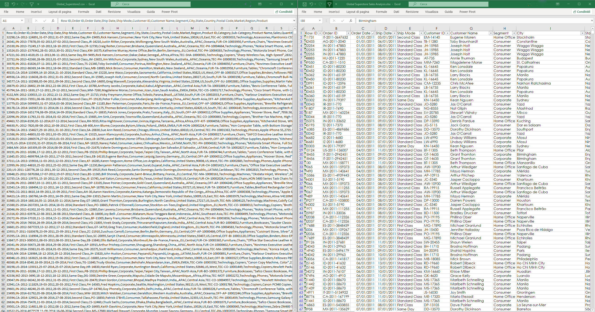
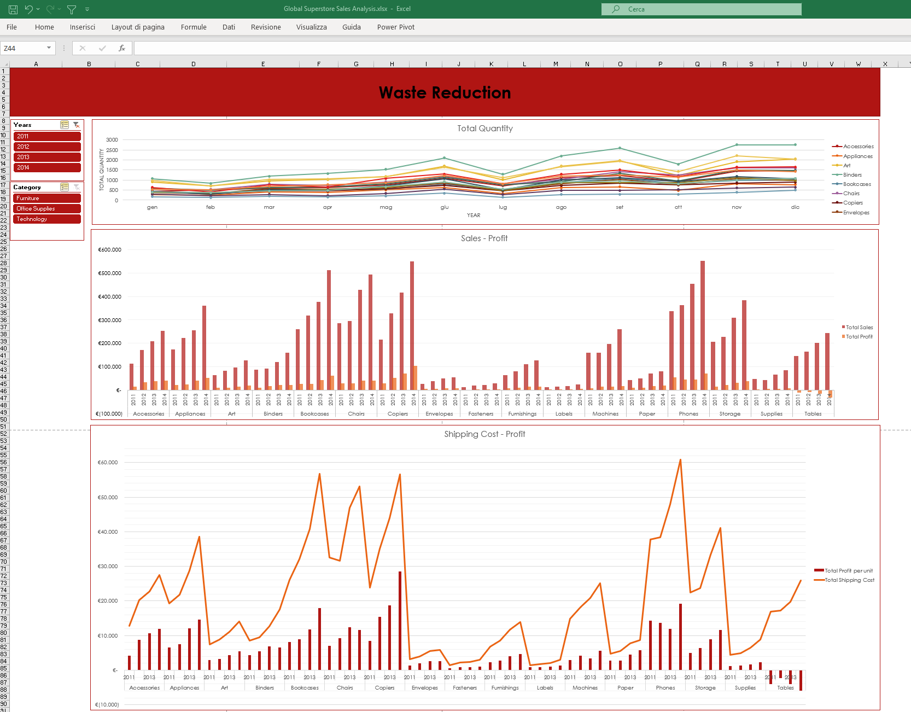
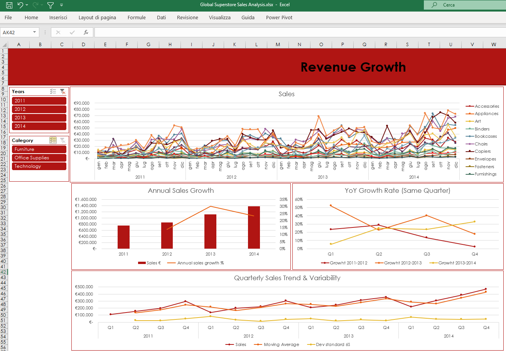
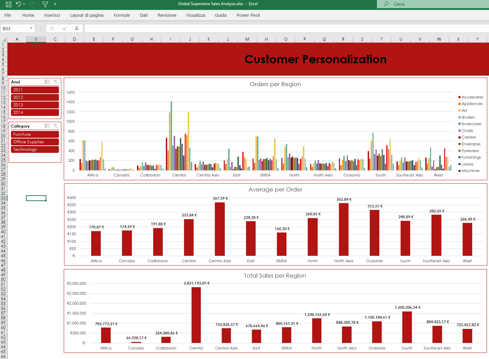
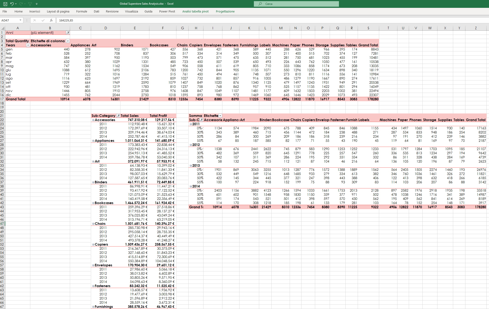

# 📊 Global Superstore Sales Analysis
## 📌 Project Overview
This project focuses on the analysis of the Global Superstore dataset, with the aim of exploring sales performance, profitability, customer behavior, and geographical trends.

Using Microsoft Excel, the dataset was cleaned, organized, and analyzed to identify business patterns, evaluate sales performance across different product categories and geographical areas, and obtain profitability insights.

The project combines Excel formulas, pivot tables, charts, and descriptive statistical techniques to transform raw data into meaningful business insights.

## 🗂️ Dataset
**Source:** Kaggle – Global Superstore Dataset

**Dataset:** Global Superstore2

## 🎯 Business Objectives
The main objectives of the project were:

- Analyze sales performance across different product categories and geographical areas.
- Evaluate product profitability and the relationship between discounts and profits.
- Examine shipping costs and their impact on business profitability.
- Identify sales and profit trends over time.
- Analyze product quantities sold and their evolution across different years.
- Apply statistical techniques to understand sales and profitability patterns.
- Explore customer purchasing behavior to identify opportunities for customer personalization.
- Support data-driven business decisions through structured analysis and visualization.

  ## 🛠️ Tools & Techniques
- Microsoft Excel
- Data Cleaning and Organization
- Excel Formulas and Functions
- Pivot Tables
- Data Visualization and Charts
- Descriptive Statistics
- Percentage Calculations
- Year-over-Year Growth Analysis
- Profitability Analysis
- Discount Analysis
- Shipping Cost Analysis
- Geographical Analysis
  
## 📂 Project Structure
The Excel workbook is organized into eight worksheets, covering data preparation and three main analytical areas.

## 1. Data Preparation
Worksheets:

- Global Superstore
- Cleaned Data
- The original dataset was imported, cleaned, and structured to ensure consistency and prepare the data for further analysis.

Key activities:

- Data cleaning and organization.
- Preparation of the dataset for analytical processing.
- Organization of transactional information for further analysis.

## 2. Waste Reduction Analysis
Worksheet: **Waste Reduction**

This analysis focuses on evaluating product performance and profitability across different product categories over the period 2011–2014.

The objective is to identify potential inefficiencies in sales and profitability by examining the relationship between product quantities sold, revenue, profit, shipping costs, and discounts.

Key analytical activities:

- **Sales Volume Analysis:** Comparison of product quantities sold across different categories and years (2011–2014).
- **Revenue and Profit Analysis:** Evaluation of total sales and total profit by product category, comparing annual performance.
- **Shipping Cost Analysis:** Comparison of shipping costs and product profitability across categories and years.
- **Average Profit Percentage:** Calculation and comparison of average profit percentages for each product category and year.
- **Profit Growth Analysis:** Calculation of year-over-year profit growth percentages by product category.
- **Discount Analysis:** Examination of discount percentages in relation to product categories and quantities sold.

## 3. Revenue Growth Analysis
Worksheet: **Revenue Growth**

This analysis focuses on evaluating sales performance and revenue trends across different product categories over the period 2011–2014.

The objective is to identify annual and quarterly growth patterns, monitor sales variability, and understand the evolution of profitability over time.

Key analytical activities:

- **Sales Performance Analysis:** Analysis of product sales across different categories throughout the years.
- **Year-over-Year (YoY) Growth Analysis:** Calculation of annual sales growth percentages and comparison of current-year sales with the previous year across product categories.
- **Quarterly YoY Growth Rate:** Calculation of year-over-year growth rates by comparing sales performance across the same quarters of different years.
- **Quarterly Sales Trend & Variability:** Analysis of quarterly sales using a two-quarter moving average and population standard deviation to measure sales fluctuations between consecutive quarters.
- **Average Profit Percentage:** Calculation and comparison of average profit percentages across product categories for each year.
- **Profit and Sales Volume Comparison:** Comparison of total profit and total quantities sold across product categories and years.

## 4. Customer Personalization Analysis
Worksheet: **Customer Personalization**

This analysis focuses on exploring customer purchasing patterns across geographical regions, product categories, and subcategories over the period 2011–2014.

The goal is to understand regional purchasing behavior, evaluate order values, and identify differences in product demand across geographies and over time.

Key analytical activities:

- **Regional Order Analysis:** Analysis of the total number of orders across geographical regions, product categories, and years.
- **Average Order Value:** Calculation and comparison of average order values across regions and product categories over time.
- **Regional Sales Analysis:** Evaluation of total sales across geographical regions and product categories throughout the years.
- **Subcategory Order Analysis:** Comparison of total orders across product subcategories for each year.

## 📊 Pivot Table Analysis
The workbook also includes three dedicated worksheets containing pivot tables to support the analytical activities:

- **Pivot – Waste Reduction:** Summary of product performance, sales, profits, shipping costs, and discounts.
- **Pivot – Revenue Growth:** Supporting analysis of revenue trends, annual and quarterly growth, and profitability indicators.
- **Pivot – Customer Personalization:** Supporting analysis of geographical sales distribution, average order values, and customer purchasing behavior.
- 
Pivot tables were used to summarize and compare business indicators across product categories, geographical regions, and time periods.

## 📊 Key Findings
## 1. Waste Reduction Analysis
The analysis of product sales volumes, revenue, profitability, and shipping costs highlighted the following findings:

- **Sales Volume and Seasonality:** Sales volumes increased during the second half of the year, reaching their peak in November, suggesting seasonal variations in purchasing activity.
- **Revenue vs. Profitability:** High sales revenue did not necessarily translate into higher profitability. Phones recorded the highest revenue (€1.71M), while Copiers generated the highest total profit (€258.57K).
- **Shipping Costs and Profitability:** Phones reported the highest shipping costs (€184.90K), while Tables combined significant shipping expenses with negative profitability, highlighting potential areas for logistics cost optimization.
- **Category Profitability:** Tables was the only product category generating an overall loss (€64,083.39), despite increasing sales throughout the 2011–2014 period, suggesting the need to review its pricing and cost structure.

## 2. Revenue Growth Analysis
The analysis of sales trends, revenue growth, and profitability across product categories highlighted the following findings:

- **Annual Revenue Growth:** Total sales increased consistently between 2011 and 2014, exceeding €1.4 million in 2014. Annual sales growth remained positive, ranging between 20% and 30%.
- **Quarterly Sales Trends:** Sales revenue increased significantly during the second half of the year, reaching its peak in the fourth quarter (Q4), highlighting seasonal variations in revenue generation.
- **Profitability by Category:** Paper (19.68%) and Labels (11.99%) recorded the highest average profit margins, while Tables (-24.20%) and Machines (-4.35%) showed negative profitability, indicating potential issues within their cost and pricing structures.

## 3. Customer Personalization Analysis
The analysis of geographical sales distribution, average order values, and customer purchasing patterns highlighted the following findings:

- **Geographical Sales Distribution:** Central recorded the highest total sales among the analyzed geographical regions, followed by South, North, and Oceania. Canada and Caribbean reported the lowest sales figures, highlighting differences in revenue contribution across geographical markets.
- **Average Order Value:** Central Asia and North Asia recorded the highest average order values, followed by Oceania. Conversely, EMEA, Africa, and Canada showed lower average order values, highlighting differences in customer purchasing behavior across geographical areas.
- **Subcategory Order Trends:** All product subcategories showed an overall increase in order volumes between 2011 and 2014, indicating growing purchasing activity across different product segments.

## 💡 Business Value
The analysis provides a structured overview of business performance and supports data-driven decision-making.

Potential business benefits include:

- **Improved Profitability Monitoring:** Identifying product categories with low or negative profitability and highlighting opportunities to review pricing and cost structures.
- **Better Sales Planning:** Understanding annual growth patterns and seasonal variations to support sales forecasting and inventory planning.
- **Logistics Cost Optimization:** Monitoring shipping expenses across product categories to identify potential areas for operational improvement.
- **Customer-Oriented Strategies:** Analyzing geographical purchasing patterns and average order values to support more targeted marketing and customer engagement strategies.
- **Data-Driven Decision-Making:** Transforming transactional data into meaningful business insights through structured analysis and visualization.

## 🎓 Conclusion
This project demonstrates how Microsoft Excel can be used as an effective tool for business data analysis, transforming raw transactional data into meaningful insights to support business decision-making.

By combining data cleaning, Excel formulas, pivot tables, charts, and descriptive statistical techniques, the project explores different aspects of sales performance, revenue growth, product profitability, and customer purchasing behavior.

The analysis highlights significant differences in product profitability, identifies potential opportunities for logistics cost optimization, reveals seasonal sales patterns, and provides insights into geographical purchasing trends.

Overall, this project strengthened my practical skills in data analysis, statistical interpretation, data visualization, and business-oriented problem-solving using Microsoft Excel.

## 📁 Repository Contents
 - **[Global_Superstore_Sales_Analysis.xlsx](Global_Superstore_Sales_Analysis.xlsx)** Completed Excel workbook containing the original dataset, cleaned data, analytical worksheets, and pivot tables.
 - **[Global_Superstore2.csv](./Global_Superstore2.csv):** Original Global Superstore dataset used for the analysis.
 - **[images](images):** Folder containing screenshots of the eight Excel workbook worksheets.
   
## 📸 Project Preview
### 1. Data Preparation
The cleaned dataset, organized and prepared for analysis.

### 2. Waste Reduction Analysis
Analysis of product quantities, profitability, shipping costs, and discounts.

### 3. Revenue Growth Analysis
Visualization of annual revenue growth and quarterly sales trends.

### 4. Customer Personalization Analysis
Analysis of geographical sales distribution, average order values, and customer purchasing patterns.

### 5. Pivot Tables
Overview of the pivot tables supporting the three analytical areas.

## 📬 Contact
- **Silvia Venturini**
- [LinkedIn](https://www.linkedin.com/in/silvia-venturini92/)
- **Email:** silvia.venturini92@hotmail.com
